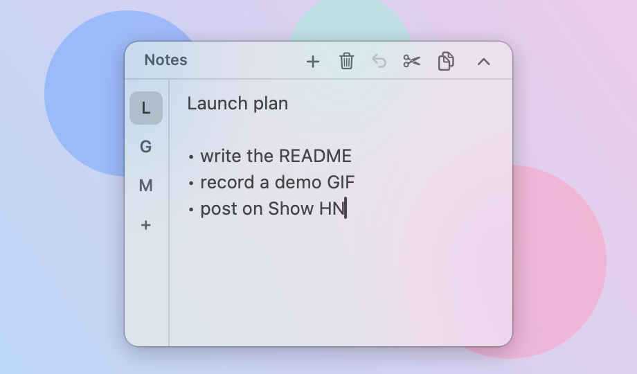

# FloatNote

**A tiny floating sticky note for macOS.** It lives as a small circle on top of everything. Click it to open your notes, click again to tuck it away.

<p align="center">
  
</p>

- **One click, no window juggling.** A floating circle stays above every app. Click to expand, `Esc` or the chevron to collapse.
- **Multiple notes with side tabs.** Up to 8 notes. Each tab shows the first letter of its note.
- **Built for quick capture.** Copy, cut-and-clear (with undo), delete and new-note buttons live in the header.
- **Stays out of your way.** No Dock icon, no menu bar icon. It remembers where you put it and never opens off-screen.
- **Your data stays yours.** Notes are plain JSON in `~/Library/Application Support/FloatNote/`. No account, no network, no telemetry.
- **Tiny and dependency-free.** One Swift file (under 800 lines, AppKit only), built with `swiftc`. No Xcode project needed.

<p align="center">
  
</p>

## Install

FloatNote is distributed as source. Building takes a few seconds.

Requirements: macOS 13 or later and the Xcode Command Line Tools (`xcode-select --install`).

```sh
git clone https://github.com/xoevip-web/FloatNote.git
cd FloatNote
./build.sh
open FloatNote.app
```

Optionally drag `FloatNote.app` to `/Applications`. On first launch it registers itself as a login item (you can turn that off from the right-click menu).

> Keep the folder out of iCloud Drive / Dropbox-style synced locations while building: their extended attributes make code signing fail.

## Usage

| Do this | To get this |
| --- | --- |
| Click the circle | Expand the notes |
| Click the header or the chevron, or press `Esc` | Collapse back to a circle |
| Drag the circle or the header | Move it (it remembers the position) |
| Drag an edge of the expanded window | Resize it |
| Click a side tab / `+` | Switch note / create a note |
| Right-click a side tab | Delete that note |
| Header buttons | New, delete, undo, cut (copy + clear), copy |
| Right-click the circle or the header | Launch at Login, Quit |
| `⌘Q` while editing | Quit |

Deleting a note that has content asks for confirmation. Undo steps back the last edit of the current note, including a cut.

## Where are my notes?

`~/Library/Application Support/FloatNote/notes.json`. It is plain JSON, so you can back it up or sync the folder with whatever you like.

## Development

```sh
./build.sh                                   # builds FloatNote.app next to the script
FLOATNOTE_PROFILE=dev ./FloatNote.app/Contents/MacOS/FloatNote
```

`FLOATNOTE_PROFILE=<name>` runs an isolated instance with its own notes and settings, so you can experiment without touching your real notes. It also never registers a login item.

## Known limitations

- Developed and tested on macOS 26 only. It should work on macOS 13+, but older versions are untested.
- Behaviour over full-screen apps and on multi-display setups is lightly tested.
- Plain text only. No global hotkey and no sync yet.
- Not notarized, which is why it is distributed as source.

Ideas and pull requests are welcome. Good first issues: a global hotkey, an optional menu bar icon, light/dark tint options.

## License

[MIT](LICENSE)
